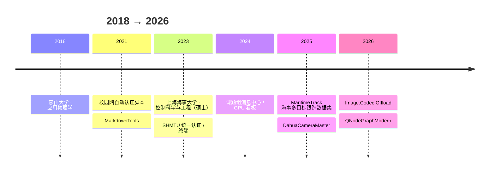
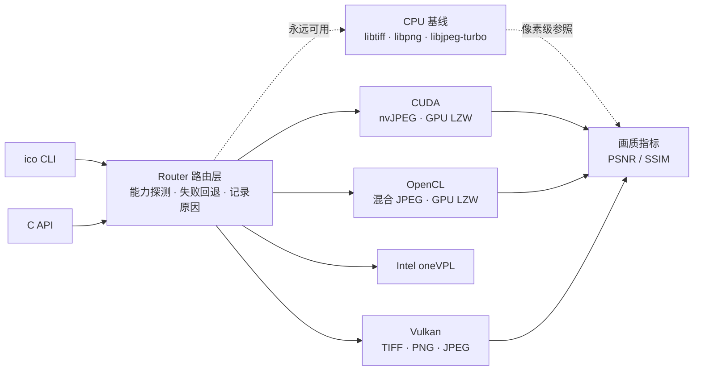

<div align="center">


### 孔昊旻 · Haomin Kong

**控制科学与工程 硕士在读** · 上海海事大学　｜　**应用物理学 学士** · 燕山大学

`Embedded` · `GUI` · `Computer Vision` · `GPU / 异构计算`

<a href="mailto:a645162@gmail.com"></a>
<a href="https://blog.csdn.net/a645162"></a>
<a href="https://www.zhihu.com/people/khm123"></a>
<a href="https://space.bilibili.com/10931556"></a>
<a href="https://www.youtube.com/channel/UC4f5q7gwzWNzDmfMTuyVp4Q"></a>

<br>


<br>


<br>

<a href="https://github.com/a645162"></a>
<a href="https://github.com/a645162"></a>
<a href="https://github.com/a645162?tab=repositories"></a>
<a href="https://github.com/a645162"></a>

希望跟大家一起多多交流。

</div>

## 🚀 最近在做什么

- **Image.Codec.Offload** — 把 GB 级图像编解码卸载到 GPU：CUDA / OpenCL / Vulkan / Intel oneVPL 四个后端，加一层会解释每次回退原因的路由，CPU 基线做像素级参照。
- **QNodeGraphModern** — C++23 + Qt 6/QML 的可复用节点图库，宿主应用通过 CMake target 直接链接。
- **SHMTU Terminal** — 上海海事大学校园终端聚合包，提供 CLI 入口与 Python SDK。

## 🔬 研究方向

| 方向 | 在做什么 | 相关项目 |
| :--- | :--- | :--- |
| **海事多目标跟踪** | 多场景、多环境、多任务的海事 MOT 数据与评测 | [MaritimeTrack](https://github.com/a645162/MaritimeTrack) · [mot-toolkit](https://github.com/a645162/mot-toolkit) |
| **GPU 图像编解码** | 大图编解码卸载、后端路由与回退、画质指标对拍 | [ImageCodecOffload](https://github.com/a645162/ImageCodecOffload) |
| **嵌入式与桌面 GUI** | C++/Qt、.NET/Avalonia、跨平台输入与设备控制 | [QNodeGraphModern](https://github.com/a645162/QNodeGraphModern) · [InputSimulatorCpp](https://github.com/a645162/InputSimulatorCpp) |
| **校园信息化** | 统一认证、验证码识别、消息推送与看板 | [shmtu-auth](https://github.com/a645162/shmtu-auth) · [group-center](https://github.com/a645162/group-center) |

## 📦 最新项目

| | |
| :---: | :---: |
| <a href="https://github.com/a645162/ImageCodecOffload"></a> | <a href="https://github.com/a645162/QNodeGraphModern"></a> |
| <a href="https://github.com/a645162/EverythingSDK"></a> | <a href="https://github.com/a645162/shmtu-terminal"></a> |

## 🧩 项目详解

### Image.Codec.Offload

> 把 GB 级 BMP / TIFF / PNG 的编解码卸载到 GPU，而不是在 CPU 上硬扛。

- **问题**：大图编解码在 CPU 上是瓶颈；不同机器上可用的硬件后端又完全不一样。
- **做法**：CUDA / OpenCL / Vulkan / Intel oneVPL 四个后端，加一层路由：选择后端、失败自动回退，并把**每次回退的原因**返回给调用方；CPU 基线始终可用，同时充当像素级参照。
- **验证**：`ico` CLI 提供 `backends / info / encode / decode / compare`，端到端测试覆盖往返、灰度保真、三后端对拍与 golden 指标。
- **栈**：`C++23` `CMake` `CUDA` `nvJPEG` `OpenCL` `Vulkan` `oneVPL`

### MaritimeTrack

> 一个大规模、多场景、多环境、多任务的海事多目标跟踪数据集。

- 面向海上场景的 MOT 数据与评测基准，覆盖不同环境与任务设置。
- 相关的跟踪工具链与实验代码见 `mot-toolkit`。
- **栈**：`Python` `Multi-Object Tracking` `Dataset`

### QNodeGraphModern

> C++23 + Qt 6/QML 的可复用节点图库，不是一个成品应用。

- 图模型核心与 Qt 解耦，宿主应用通过 CMake target 直接链接。
- 提供 QML 层与 examples，方便嵌入到自己的编辑器 / 工具里。
- **栈**：`C++23` `Qt 6` `QML` `CMake`

### SHMTU Terminal

> 上海海事大学校园终端聚合包：CLI 入口 + Python SDK。

- 聚合 CAS 登录、验证码识别、数据同步等子模块能力。
- 同一套能力在 Python / Rust / Kotlin / C# 多端落地过（终端、桌面、Android）。
- **栈**：`Python` `Rust` `Kotlin` `C#` `.NET`

## 🧭 我的路线



## 🏗 Image.Codec.Offload 架构



## 🐍 贡献图

<picture>
  <source media="(prefers-color-scheme: dark)" srcset="https://raw.githubusercontent.com/a645162/a645162/output/github-contribution-grid-snake-dark.svg">
  <source media="(prefers-color-scheme: light)" srcset="https://raw.githubusercontent.com/a645162/a645162/output/github-contribution-grid-snake.svg">
  
</picture>

## 🚀 最近发布

<!--START_SECTION:releases-->
- [v2.0.5](https://github.com/a645162/shmtu-cas-ocr-model/releases/tag/v2.0.5) · **shmtu-cas-ocr-model** · 2026-06-11
- [v2.0.0](https://github.com/a645162/shmtu-cas-ocr-server/releases/tag/v2.0.0) · **shmtu-cas-ocr-server** · 2026-05-29
- [v2.2.0](https://github.com/a645162/shmtu-auth/releases/tag/v2.2.0) · **shmtu-auth** · 2025-07-05
- [v1.1.4](https://github.com/a645162/shmtu-cas-demo-android/releases/tag/v1.1.4) · **shmtu-cas-demo-android** · 2025-06-27
- [v1.0.0](https://github.com/a645162/shmtu-cas-ocr-demo-qt/releases/tag/v1.0.0) · **shmtu-cas-ocr-demo-qt** · 2024-04-09
- [v1.0.0](https://github.com/a645162/shmtu-cas-ocr-demo-windows/releases/tag/v1.0.0) · **shmtu-cas-ocr-demo-windows** · 2024-04-09
<!--END_SECTION:releases-->

## 📝 近期动态

<sup>CSDN（点个 <a href="https://github.com/a645162/a645162">Star</a> 将触发自动刷新）</sup>

<!-- BLOG-POST-LIST:START -->
- 🔭 [Ubuntu 22.04 下安装最新版本的 Wine](https://blog.csdn.net/a645162/article/details/131099149)
- 💂 [Android DND&lpar;Do Not Disturb&rpar; Access API的学习](https://blog.csdn.net/a645162/article/details/87471283)<!-- BLOG-POST-LIST:END -->

<sup>知乎（点个 <a href="https://github.com/a645162/a645162">Star</a> 将触发自动刷新）</sup>

<!-- ZHIHU-POST-LIST:START -->
- 🔭 [所有手机品牌息屏听剧，为啥只有小米有?](http://www.zhihu.com/question/6292080759?utm_campaign=rss&utm_medium=rss&utm_source=rss#answer-1891560953226708368) | Apr 4, 2025
- 💂 [怎样用Python实现对Xbox手柄的控制？](http://www.zhihu.com/question/371216417?utm_campaign=rss&utm_medium=rss&utm_source=rss#answer-9385693696) | Oct 19, 2024
- 🌁 [manjaro kde如何在两台分辨率不同的显示器上扩展桌面并各自保持各自的缩放比例？](http://www.zhihu.com/question/428086099?utm_campaign=rss&utm_medium=rss&utm_source=rss#answer-3071055518) | Jun 12, 2023
- 🙉 [Windows Defender 安全中心 能否关闭？](http://www.zhihu.com/question/290677509?utm_campaign=rss&utm_medium=rss&utm_source=rss#answer-3068809159) | Jun 11, 2023
- 🥷 [python Matplotlib 生成 EPS 矢量图无法显示中文？](http://www.zhihu.com/question/23541723?utm_campaign=rss&utm_medium=rss&utm_source=rss#answer-890564176) | Nov 11, 2019<!-- ZHIHU-POST-LIST:END -->

## 🧑‍💻 开发概览

<!--START_SECTION:waka-->


**🐱 My GitHub Data** 

> 📦 1.1 MB Used in GitHub's Storage 
 > 
> 🏆 1,290 Contributions in the Year 2026
 > 
> 💼 Opted to Hire
 > 
> 📜 150 Public Repositories 
 > 
> 🔑 63 Private Repositories 
 > 
**I'm a Night 🦉** 

```text
🌞 Morning                975 commits         ███░░░░░░░░░░░░░░░░░░░░░░   10.69 % 
🌆 Daytime                3540 commits        ██████████░░░░░░░░░░░░░░░   38.80 % 
🌃 Evening                3377 commits        █████████░░░░░░░░░░░░░░░░   37.02 % 
🌙 Night                  1231 commits        ███░░░░░░░░░░░░░░░░░░░░░░   13.49 % 
```
📅 **I'm Most Productive on Thursday** 

```text
Monday                   1171 commits        ███░░░░░░░░░░░░░░░░░░░░░░   12.84 % 
Tuesday                  1375 commits        ████░░░░░░░░░░░░░░░░░░░░░   15.07 % 
Wednesday                1125 commits        ███░░░░░░░░░░░░░░░░░░░░░░   12.33 % 
Thursday                 1601 commits        ████░░░░░░░░░░░░░░░░░░░░░   17.55 % 
Friday                   1274 commits        ███░░░░░░░░░░░░░░░░░░░░░░   13.96 % 
Saturday                 1282 commits        ████░░░░░░░░░░░░░░░░░░░░░   14.05 % 
Sunday                   1295 commits        ████░░░░░░░░░░░░░░░░░░░░░   14.19 % 
```


📊 **This Week I Spent My Time On** 

```text
🕑︎ Time Zone: Asia/Shanghai

💬 Programming Languages: 
C++                      11 hrs 42 mins      ███████░░░░░░░░░░░░░░░░░░   26.62 % 
Python                   8 hrs 41 mins       █████░░░░░░░░░░░░░░░░░░░░   19.77 % 
C#                       6 hrs 39 mins       ████░░░░░░░░░░░░░░░░░░░░░   15.13 % 
Markdown                 5 hrs 7 mins        ███░░░░░░░░░░░░░░░░░░░░░░   11.68 % 
Other                    3 hrs 21 mins       ██░░░░░░░░░░░░░░░░░░░░░░░   07.66 % 

🔥 Editors: 
Opencode Cli             26 hrs 40 mins      ███████████████░░░░░░░░░░   60.66 % 
VS Code                  15 hrs 47 mins      █████████░░░░░░░░░░░░░░░░   35.91 % 
OpenCode                 1 hr 19 mins        █░░░░░░░░░░░░░░░░░░░░░░░░   03.03 % 
Obsidian                 10 mins             ░░░░░░░░░░░░░░░░░░░░░░░░░   00.41 % 
IntelliJ IDEA            0 secs              ░░░░░░░░░░░░░░░░░░░░░░░░░   00.00 % 

🐱‍💻 Projects: 
BEIM.LogHelperQ          8 hrs 50 mins       █████░░░░░░░░░░░░░░░░░░░░   20.11 % 
BEIM.AlgorithmHost       7 hrs 33 mins       ████░░░░░░░░░░░░░░░░░░░░░   17.19 % 
BEIM.Base.Qt.BaseWidget  7 hrs 8 mins        ████░░░░░░░░░░░░░░░░░░░░░   16.26 % 
ImageViewerQt            5 hrs 43 mins       ███░░░░░░░░░░░░░░░░░░░░░░   13.01 % 
BEIM.SwissKnife          5 hrs 9 mins        ███░░░░░░░░░░░░░░░░░░░░░░   11.73 % 

💻 Operating System: 
Linux                    25 hrs 21 mins      ██████████████░░░░░░░░░░░   57.67 % 
Windows                  18 hrs 36 mins      ███████████░░░░░░░░░░░░░░   42.33 % 
```

🤖 **AI Coding This Week** 

```text
⏱ AI Coding Time: 39 hrs 48 mins (90.55%)

✍️ 81,175 lines written by AI, 386 lines written by hand (99.53% AI-written)

🔤 29,101,676 Input Tokens, 7,504,398 Output Tokens

💵 $5953.36 Estimated AI Cost This Week

🧠 68 AI Sessions, 505 AI Prompts

DeepSeek                 83,493 lines        █████████████████████████   100.00 % 
M                        0 lines             ░░░░░░░░░░░░░░░░░░░░░░░░░   00.00 % 

🔎 AI Coding Insights:
🤖 AI-Driven — 99.53% of written lines came from AI
📝 Concise Prompter — average 476 characters per prompt
🔁 Iterative Prompter — average 7 prompts per session
🚀 High AI Trust — 0.79% of changed lines were hand-edited
```

**I Mostly Code in Python** 

```text
Python                   53 repos            ███████████░░░░░░░░░░░░░░   42.40 % 
C++                      16 repos            ███░░░░░░░░░░░░░░░░░░░░░░   12.80 % 
C#                       12 repos            ██░░░░░░░░░░░░░░░░░░░░░░░   09.60 % 
Kotlin                   9 repos             ██░░░░░░░░░░░░░░░░░░░░░░░   07.20 % 
JavaScript               3 repos             █░░░░░░░░░░░░░░░░░░░░░░░░   02.40 % 
```


 Last Updated on 19/11/2026 07:10:10 UTC
<!--END_SECTION:waka-->

## 📊 年度语言分布

<a href="https://wakatime.com/@a645162"></a>

**Last 365 days I Spent My Time On:**（右侧是公开仓库的代码量分布，和 WakaTime 的编辑器时长口径不同）

<!--START_SECTION:waka-year-->

```txt
From: 18 November 2025 - To: 18 November 2026

Total Time: 1,088 hrs 10 mins

C#                                 228 hrs 37 mins       🟩🟩🟩🟩🟩🟨⬜⬜⬜⬜⬜⬜⬜⬜⬜⬜⬜⬜⬜⬜⬜⬜⬜⬜⬜   21.01 %
C++                                167 hrs 37 mins       🟩🟩🟩🟩⬜⬜⬜⬜⬜⬜⬜⬜⬜⬜⬜⬜⬜⬜⬜⬜⬜⬜⬜⬜⬜   15.40 %
Markdown                           160 hrs 37 mins       🟩🟩🟩🟨⬜⬜⬜⬜⬜⬜⬜⬜⬜⬜⬜⬜⬜⬜⬜⬜⬜⬜⬜⬜⬜   14.76 %
Python                             157 hrs 12 mins       🟩🟩🟩🟨⬜⬜⬜⬜⬜⬜⬜⬜⬜⬜⬜⬜⬜⬜⬜⬜⬜⬜⬜⬜⬜   14.45 %
Other                              74 hrs 45 mins        🟩🟨⬜⬜⬜⬜⬜⬜⬜⬜⬜⬜⬜⬜⬜⬜⬜⬜⬜⬜⬜⬜⬜⬜⬜   06.87 %
```

<!--END_SECTION:waka-year-->

<br clear="right">

## 📈 年度概览


<p align="center">
  
</p>

## 🧰 我在用

<p align="center">
  
  
  
  
  
  
  
  
  
</p>

<p align="center">
  
  
  
  
  
  
</p>

<details>
<summary><b>🚢 硕士期间为上海海事大学（课题组）开发的项目（点击展开）</b></summary>

<br>

海狮的信息化程度很高，许多服务都是数字化的，因此我们可以用这些接口开发一些软件。欢迎诸位同学为 SHMTU 贡献项目，有想法可以来咨询我。

| | |
| :---: | :---: |
| <a href="https://github.com/a645162/shmtu-auth"></a> | <a href="https://github.com/a645162/group-center"></a> |
| <a href="https://github.com/a645162/nvi-notify"></a> | <a href="https://github.com/a645162/nvi-fan-control"></a> |
| <a href="https://github.com/a645162/group-center-dashboard"></a> | <a href="https://github.com/a645162/web-gpu-dashboard"></a> |
| <a href="https://github.com/a645162/shmtu-dotnet-lib"></a> | <a href="https://github.com/a645162/shmtu-cas-go"></a> |
| <a href="https://github.com/a645162/shmtu-cas-ocr-server"></a> | <a href="https://github.com/a645162/shmtu-cas-kotlin"></a> |
| <a href="https://github.com/a645162/shmtu-cas-ocr-model"></a> | <a href="https://github.com/a645162/shmtu-cas-ocr-demo-windows"></a> |
| <a href="https://github.com/a645162/shmtu-cas-ocr-demo-qt"></a> | <a href="https://github.com/a645162/shmtu-cas-demo-android"></a> |
| <a href="https://github.com/a645162/Digital-SHMTU-Tools"></a> | <a href="https://github.com/EricHongXDD/smu_course_election_helper"></a> |

</details>

<details>
<summary><b>🏫 本科期间 & 其他开源项目（点击展开）</b></summary>

<br>

| | |
| :---: | :---: |
| <a href="https://github.com/a645162/ysuauth"></a> | <a href="https://github.com/a645162/KDEHighDPI"></a> |
| <a href="https://github.com/a645162/MarkdownTools"></a> | <a href="https://github.com/a645162/QQChatConvertR"></a> |
| <a href="https://github.com/a645162/Nvidia-Tesla-WDDM-Tools"></a> | <a href="https://github.com/a645162/HomeWorkNewYearVideo"></a> |
| <a href="https://github.com/a645162/SHMTU-Beamer-Theme"></a> | <a href="https://github.com/a645162/SHMTU-CV"></a> |

</details>

<div align="center">


</div>
